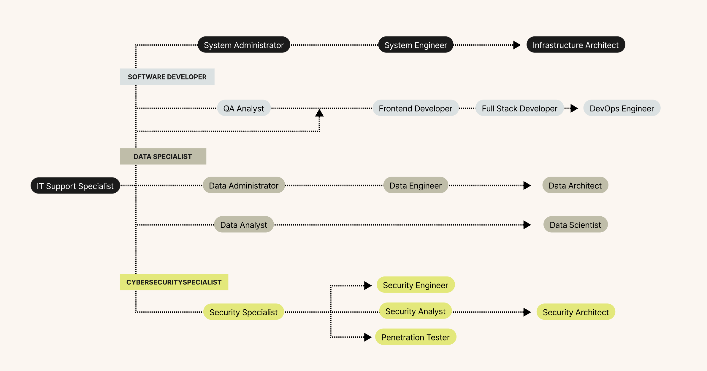
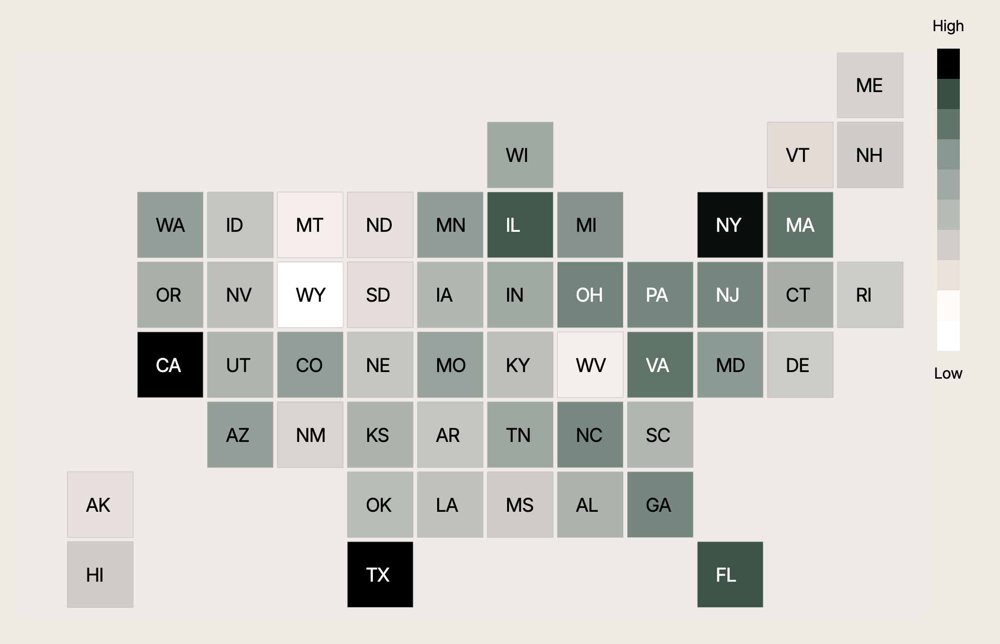
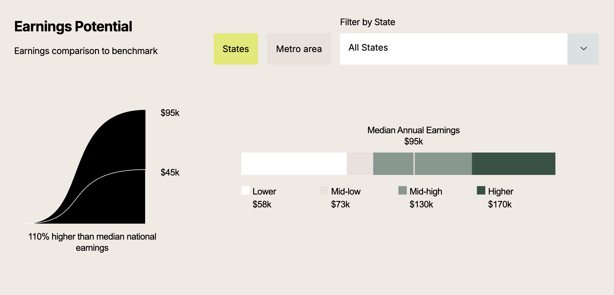
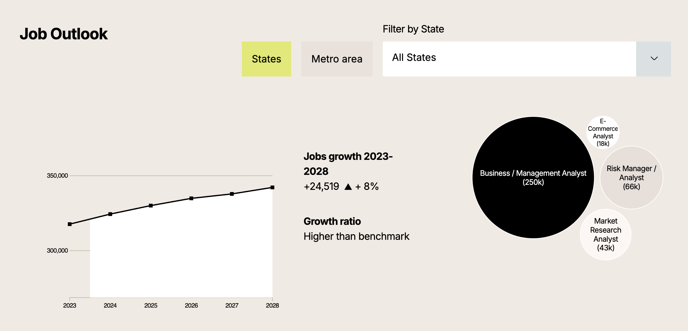
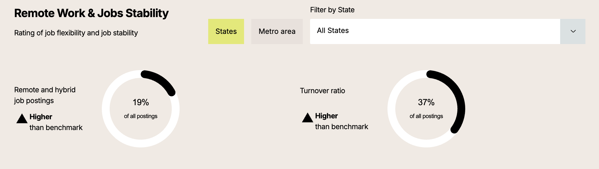

<video style="width:90%;margin-top:-10px;" autoplay loop muted playsinline>
  <source src="/images/projects/comptia-job-exploration/video.mp4" type="video/mp4">
</video>

CompTIA Careers+ helps people start, change, or advance in tech by combining a career quiz, personalized role suggestions, and practical next steps.

It connects users with role guidance, local salary context, and career resources in a simple journey-first experience.

 
Live website: [explore.comptia.org](https://explore.comptia.org/).

 
In partnership with [infogr8](https://infogr8.com/) — [read the case study](https://infogr8.com/our-work/comptia-career-explorer-2/).

  
  
  
  
  
  
  
  
  
  

