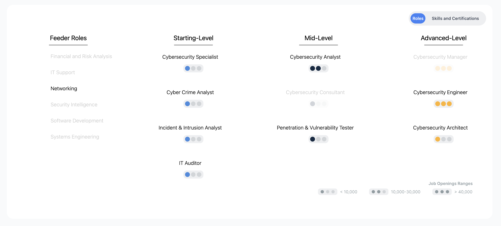

<video style="width:90%;margin-top:-10px;" autoplay loop muted playsinline>
  <source src="/images/projects/comptia-cyberseek/video.mp4" type="video/mp4">
</video>

CyberSeek helps users explore the cybersecurity labor market through interactive tools and up-to-date workforce data.

It includes Workforce Map, Career Pathway, and Education & Training dashboards, helping students, professionals, employers, and policymakers understand demand, supply, and hiring trends.

 
Live website: [cyberseek.org](https://www.cyberseek.org/).

 
In partnership with [infogr8](https://infogr8.com/) — [read the case study](https://infogr8.com/our-work/cyberseek-data-tool/).

  
  
  
  
  
  
  

