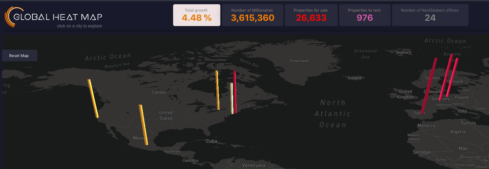
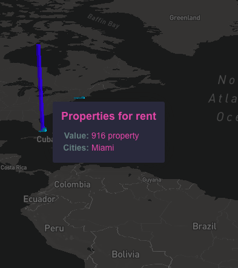
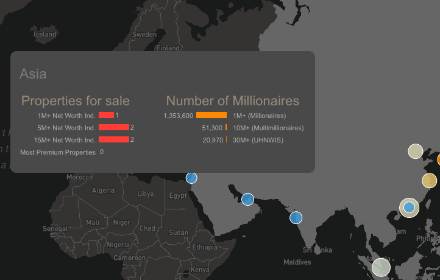

<div style="margin-bottom:60px;overflow:hidden;width:100%;display:flex;justify-content:center">
<video style="width:90%;margin-top:-10px;" autoplay loop muted playsinline  >
	<source src="/images/projects/nestseekers/video.mp4" type="video/mp4">
</video>
</div>

## Details

This map uses mapbox for background layers and deck.gl's ```HexagonLayer``` layer to display impressive 3D bars on top of mapbox


You can click on top KPI's to display other information's




Hover over the bars, to reveal additional insights




Continent insights




City insights


By clicking the city, we can show detailed view of map, where more than 50K + points are displayed

Where we can filter by category, price, see the details of each point and e.t.c


If we zoom detailed enough, we even can see 3D buildings


---

### Image gallery


<div class="gallery" data-columns="3">
	
	
	
	
    
	
	
	
</div>


