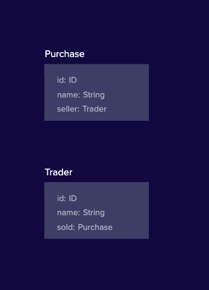
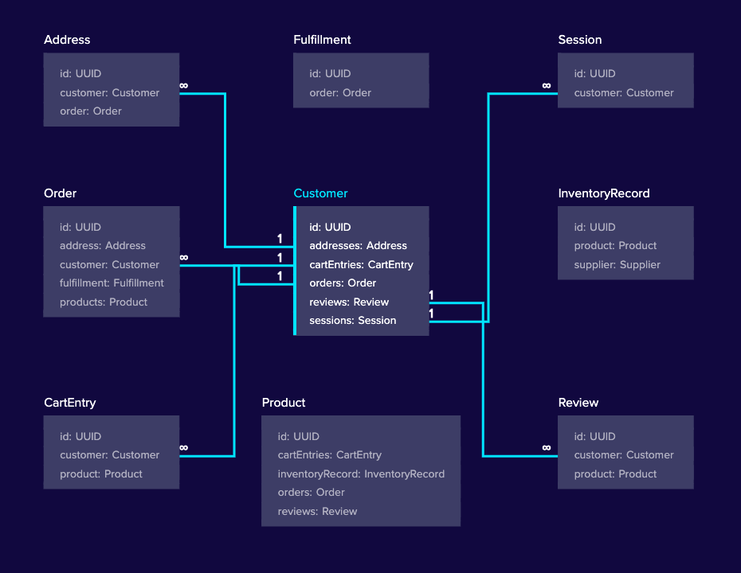
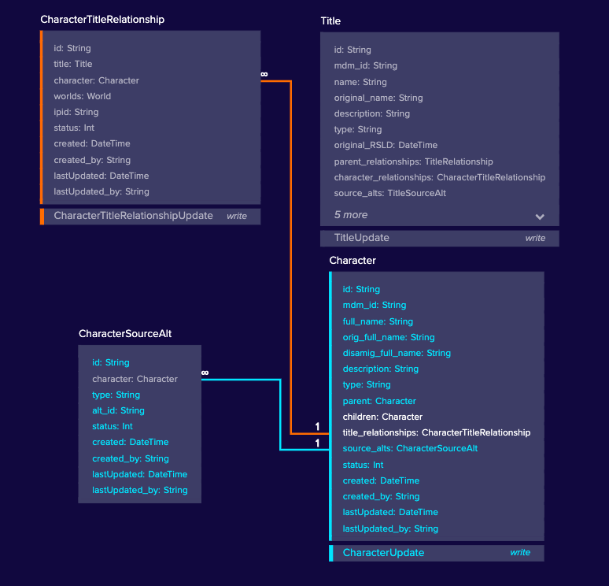
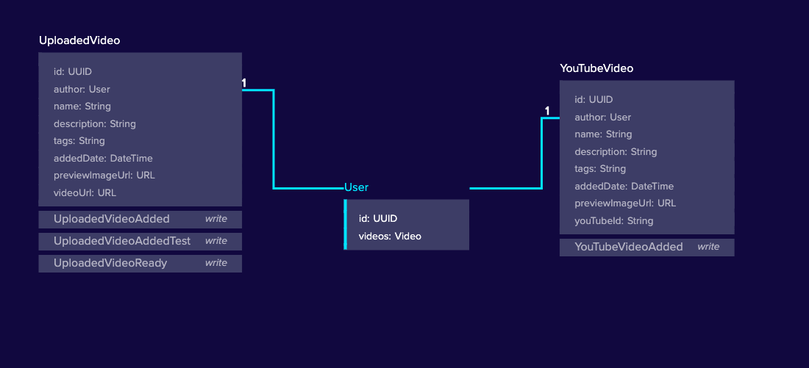

<!-- <iframe src="https://bumbeishvili.github.io/d3-matthias-upw/classdiagram/?file=c360-template" style="border:0px #ffffff none;" name="myiFrame" scrolling="no" frameborder="1" marginheight="0px" marginwidth="0px" height="600px" width="100%" allowfullscreen></iframe> -->

End product is very smooth and pretty performing, compared to built in tools in several applications 

	
    
    
    

   

