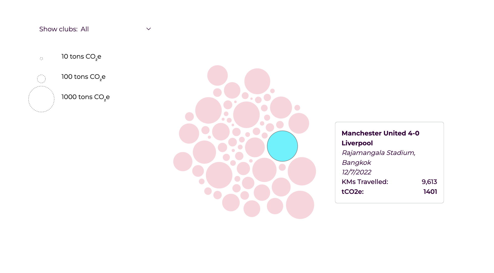

<!-- Add video view -->
 

<video style="width:90%;" autoplay loop muted playsinline  >
  <source src="/images/projects/ple-emissions/preview.mp4" type="video/mp4">
</video>

[preseasonunfriendly.com](https://www.preseasonunfriendly.com/) is a dynamic and interactive, scroll event based exploration of emissions, friendly matches emit.

In partnership with [infogr8](https://infogr8.com/).

 
Turns out a single friendly match can emit more than entire premier league 380 matches combined, which is an interesting finding to say at least.

	
	
	
    
	
  

